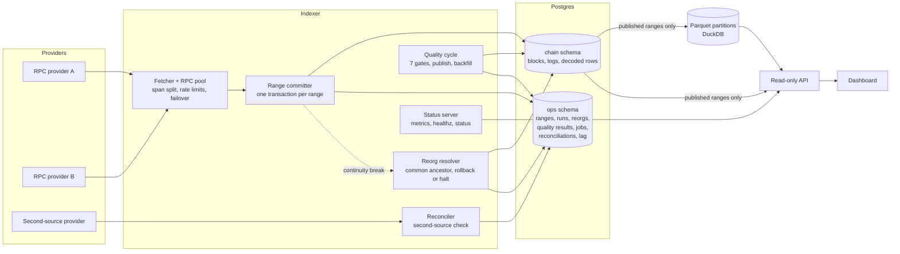

# Reorg-safe Ethereum log indexer

I built this to show that I can write the part of a blockchain data pipeline that most people hand to a framework: ingesting Ethereum mainnet logs into Postgres so that the stored data is provably complete, survives a `kill -9`, repairs itself when the chain reorganizes, and is only exposed to readers after it has passed data-quality checks. It indexes USDC `Transfer` events and the Uniswap v3 USDC/WETH 0.05% pool's `Swap` events, serves them through a read-only HTTP API, and shows the state of the pipeline (ranges, quality gates, reorgs, reconciliation) in a dashboard. TypeScript, Postgres 17, DuckDB/Parquet for analytics, Next.js for the UI, pnpm workspace.

The interesting parts are not the decoding. They are the commit protocol (one transaction per block range, the range row is the checkpoint), the reorg handling (parent-hash continuity, whole-range rollback, halt below the finalized block), and the fail-closed publish step (a range is visible only when it is finalized and all seven SQL gates pass).

## Architecture



`ops.ranges.status` moves `candidate` -> `published` (or `failed`, with one queued backfill job). Everything the API and the Parquet export serve comes from `published` ranges. Details: [docs/decisions.md](docs/decisions.md).

## What is verified, and how

| Claim | Evidence |
|---|---|
| 50,000 finalized mainnet blocks (4,155,122 logs) ingested; `kill -9` mid-batch then resume gives 0 gaps and 0 duplicates by independent SQL; 10 random windows re-fetched from a second provider match (8,684 logs, 0 mismatches) | [docs/m1-gate.md](docs/m1-gate.md). Tests: [crash-resume.int.test.ts](apps/indexer/test/crash-resume.int.test.ts), [store.int.test.ts](apps/indexer/test/store.int.test.ts) |
| Reorgs inside the finalized window are detected and rolled back; a reorg at or below the finalized block halts the indexer with exit code 2, and the halt stays in force across restarts until `ack-halt` records what was found | 13 mock-RPC replay cases ([reorg.int.test.ts](apps/indexer/test/reorg.int.test.ts), [reorg.test.ts](apps/indexer/test/reorg.test.ts)) and 7 cases against a real Anvil node using `anvil_reorg`, including halt below finalized ([reorg.anvil.test.ts](apps/indexer/test/anvil/reorg.anvil.test.ts)). Sticky-halt behaviour (a restart exits 2 without any RPC call) is in [reorg.int.test.ts](apps/indexer/test/reorg.int.test.ts). CI runs both suites 10 times as a matrix and requires all 10 green ([ci.yml](.github/workflows/ci.yml)) |
| A real mainnet reorg was handled | Reorg #1 at block 26,212,486 (depth 1, common ancestor 26,212,485), detected 2 h 49 min into the live run and rolled back. After finality the stored hash equals the canonical hash from two independent providers, and the orphaned hash is absent |
| Bad data does not reach readers | Seven SQL gates per range, fail-closed publish, deterministic backfill job ids ([quality.int.test.ts](apps/indexer/test/quality.int.test.ts)); second-source reconciliation ([reconcile.int.test.ts](apps/indexer/test/reconcile.int.test.ts)); rebuild-verify of decoded tables from landed logs ([rebuild.int.test.ts](apps/indexer/test/rebuild.int.test.ts)); end-to-end run loop ([m3-e2e.int.test.ts](apps/indexer/test/m3-e2e.int.test.ts)). Operating procedure: [docs/operations.md](docs/operations.md) |
| Dashboard works and is accessible | Playwright E2E ([apps/web/e2e](apps/web/e2e)) green in 10 of 10 CI matrix runs; Lighthouse accessibility score 100 on 6 pages |
| API is fast | Deployed-host p95 at or below 96 ms for every dashboard endpoint; table in [docs/costs-and-load.md](docs/costs-and-load.md) |
| Parquet/DuckDB analytics agree with Postgres | `verifyAnalytics`: partitions are byte-identical to a fresh rebuild from Postgres and DuckDB aggregates equal Postgres aggregates ([analytics.int.test.ts](packages/analytics/test/analytics.int.test.ts)) |

A heap leak was found by the M1 gate run (every `await` raced one never-settling abort promise; about 9 MB leaked per range, out-of-memory abort after about 230 ranges). It is fixed, and [until-aborted.test.ts](apps/indexer/test/until-aborted.test.ts) is a GC-based regression test that fails on the old pattern; see the addendum in [docs/m1-gate.md](docs/m1-gate.md#addendum-2026-10-17-after-the-gate).

Failure handling is tabulated in [docs/failure-modes.md](docs/failure-modes.md): what is detected, what the system does, and which test proves it.

## Quick start

Requirements: Node 22, pnpm 10, Postgres 17. The integration tests also need Foundry's `anvil` for the reorg suite.

```sh
pnpm install

# 1. Postgres and schema
createdb indexer
export DATABASE_URL=postgres://localhost:5432/indexer
pnpm db:migrate

# 2. Indexer against a keyless public RPC (rate limits apply; see docs/costs-and-load.md)
export RPC_PROVIDERS='[{"name":"mevblocker","url":"https://rpc.mevblocker.io","maxSpan":100,"rps":15,"batchSize":20}]'
# pick a start block a few thousand blocks below the current head
export START_BLOCK=$(node -e 'fetch("https://rpc.mevblocker.io",{method:"POST",headers:{"content-type":"application/json"},body:JSON.stringify({jsonrpc:"2.0",id:1,method:"eth_blockNumber",params:[]})}).then(r=>r.json()).then(j=>console.log(parseInt(j.result,16)-5000))')
export METRICS_PORT=3300
pnpm indexer run

# 3. API (second terminal; same DATABASE_URL)
node --import tsx apps/api/src/main.ts          # http://localhost:3200

# 4. Dashboard (third terminal)
API_URL=http://localhost:3200 pnpm --filter @rsi/web dev   # http://localhost:3100
```

Data appears in the API only after a range is finalized and has passed the gates, so a freshly started run against the head shows nothing in the transfer and swap lists for a while. `curl localhost:3300/status` shows ranges by status immediately. For Parquet analytics set `ANALYTICS_EXPORT_INTERVAL_MS` on the API process or run `pnpm tsx packages/analytics/src/cli.ts export`.

Checks:

```sh
pnpm typecheck
pnpm test                                    # unit
DATABASE_URL=postgres://localhost:5432/indexer_test pnpm test:integration   # resets the chain and ops schemas
DATABASE_URL=postgres://localhost:5432/indexer_test pnpm vitest run --project anvil   # run separately from integration
E2E_DATABASE_URL=postgres://localhost:5432/indexer_e2e pnpm --filter @rsi/web e2e
```

The integration and Anvil projects reset the schemas of the database they are given. Point them at a scratch database, never the one you are indexing into. All environment variables and CLI commands (`verify`, `rebuild-verify`, `reconciliations`, `explain-reconciliation`, `lag-report`) are in [docs/operations.md](docs/operations.md).

## Layout

| Path | Contents |
|---|---|
| `apps/indexer` | Ingestion pipeline, RPC pool, reorg resolver, quality gates, reconciler, rebuild verifier, status/metrics server, alerts, CLI |
| `apps/api` | Read-only Fastify API (fail-closed event queries, keyset pagination), optional Parquet export loop |
| `apps/web` | Next.js dashboard (overview, explorer, quality, reconciliation, reorgs, analytics) with Playwright E2E and Lighthouse checks |
| `packages/db` | Drizzle schema (`chain` and `ops` schemas) and migrations |
| `packages/contracts` | Zod schemas for the API, shared by API and dashboard |
| `packages/analytics` | Parquet export, manifest, DuckDB reader, export verification |
| `contracts` | Solidity emitters used by the Anvil reorg tests |
| `docs` | [decisions](docs/decisions.md), [failure modes](docs/failure-modes.md), [runbook](docs/runbook.md), [costs and load](docs/costs-and-load.md), [operations](docs/operations.md), [M1 gate](docs/m1-gate.md) |

## Why these choices

Short versions; the full records are in [docs/decisions.md](docs/decisions.md).

**Ethereum L1, not an L2.** The point is to show reorg handling, and L1 has real reorgs to handle. Base had one L2 reorg ever, so an L2 indexer would be mostly untested against the thing it is supposed to demonstrate. I also have a real mainnet reorg in the evidence above (ADR-001).

**Not Ponder or The Graph.** If I needed an indexer for a product, I would use [Ponder](https://ponder.sh) and not write this. It handles reorgs, checkpointing and a typed API for you, and it would get a correct indexer for these two contracts into production in an afternoon. That is also the reason I did not use it here: the exercise is the layer it hides. What I give up by building: a larger maintenance surface, no ecosystem, a single instance, and only two contracts. What I get: I can state exactly what happens on every failure in [docs/failure-modes.md](docs/failure-modes.md) and point at a test for it (ADR-002).

**Postgres plus DuckDB/Parquet.** Postgres is the source of truth because reorg-aware writes, resume checkpoints and fail-closed publishing need transactions. Scan-heavy aggregates (daily volume, OHLC) are cheaper in a columnar format, so the API reads those from Parquet partitions that are exported from published Postgres ranges only and can be rebuilt byte-for-byte from Postgres at any time (ADR-004, ADR-015).

## Limitations

- **Keyless public RPCs.** Throughput (about 13.7 blocks/s in the M1 run) and tail latency depend on free endpoints with rate limits and occasional 30 s timeouts. The failover logic is tested, but I have not run against a paid provider; the Alchemy numbers in [docs/costs-and-load.md](docs/costs-and-load.md) are a budget computed from price tables and measured call counts, not a measurement against that service.
- **Single instance.** A per-chain Postgres advisory lock stops two indexers from running at once; there is no standby and no horizontal scaling. Postgres is a single node with no replica.
- **No authentication.** The API is read-only with permissive CORS and binds to loopback by default. Put a reverse proxy in front of anything public. The indexer status server exposes internals and also binds to loopback.
- **Etherscan checks are a sample, not a census.** The JSON-RPC reconciler checks every finalized range against a second provider. Etherscan, an independent log index, re-checks a random sample (20 ranges an hour by default) to stay inside its free plan; checked against a JSON-RPC provider on a live 100-block range, both returned the same 3,755 logs. A wrong log in a range Etherscan never sampled is caught only by the RPC reconciler.
- **Two contracts, one chain.** Adding contracts means configuration plus decoder code; adding a chain is configuration, but only mainnet has been run.
- **Live-gate numbers pending.** The 72 h live gate window runs until 2026-10-20 10:59 UTC. Lag percentiles and reconciliation totals for it are marked `TODO(gate)` in [docs/costs-and-load.md](docs/costs-and-load.md).
- **Retention keeps Parquet as the only copy of old decoded days.** Storage is bounded by deleting what can be obtained again: raw logs of published ranges after `LANDING_RETENTION_DAYS` (default 7, and only with a matching second-source check when the reconciler is active), decoded rows after `DECODED_RETENTION_DAYS` (off by default, and only once the Parquet export holds them). Blocks and every `ops` table are never deleted. The limitation: once decoded rows of a day are purged, the Parquet store is the only copy of that day, so it must be backed up and must not be deleted. The exporter refuses to rewrite such a day. `rebuild-verify` and the gates that read landing logs cover only the retained window afterwards. Details: [docs/runbook.md](docs/runbook.md#retention), ADR-020.
